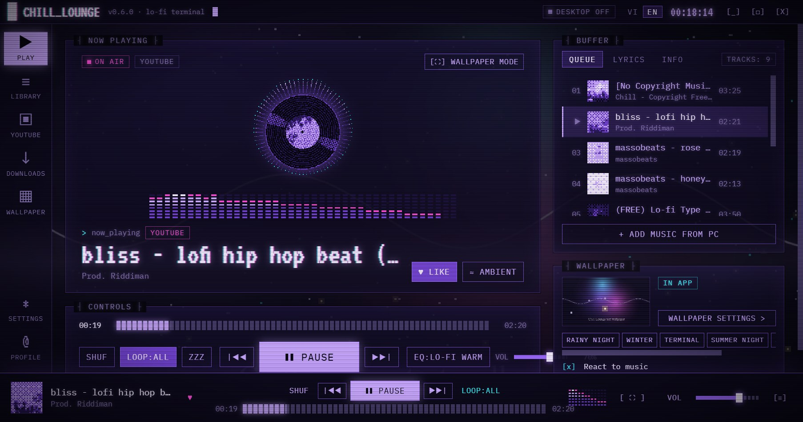
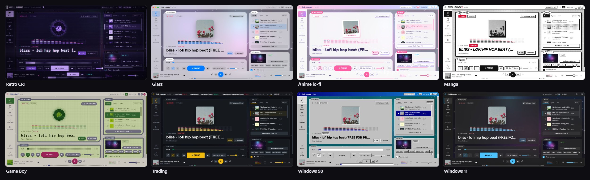
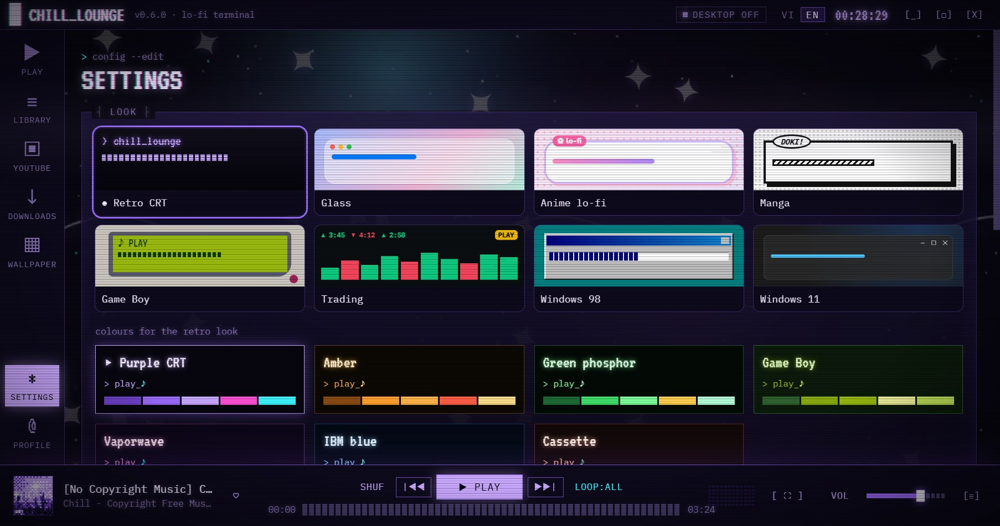
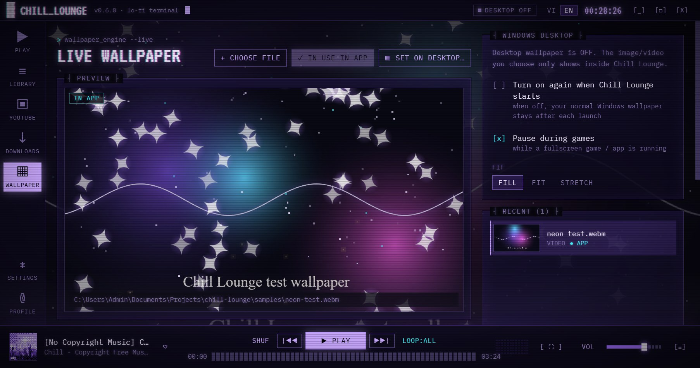
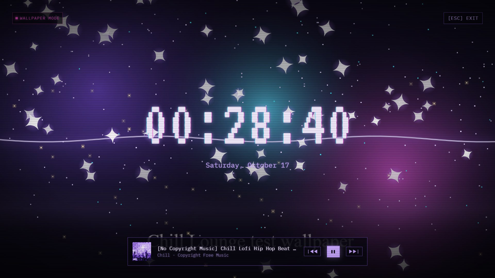
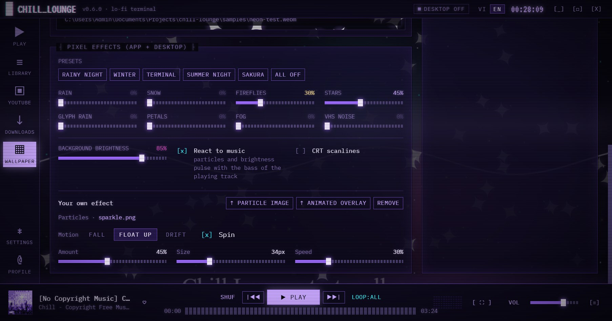
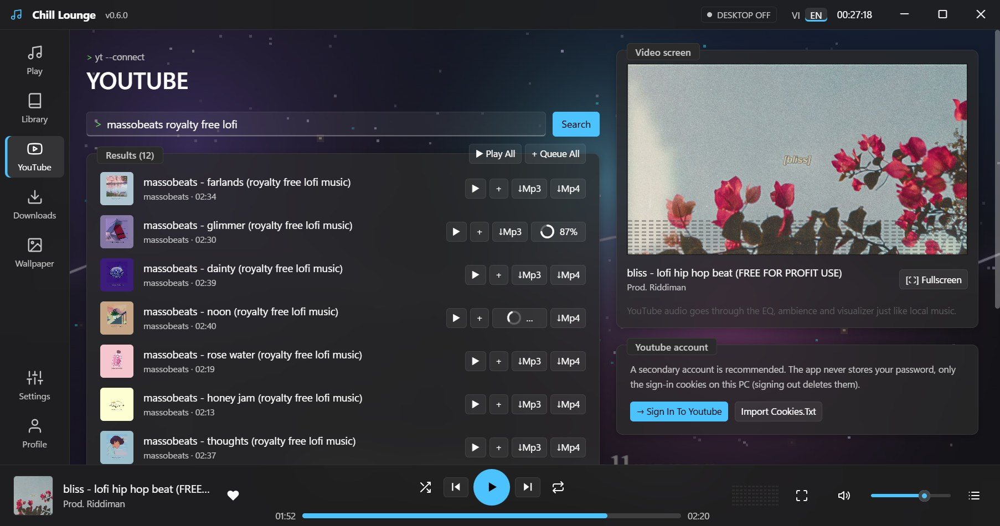

# Chill Lounge

**A live wallpaper and lo-fi music player for Windows — eight looks, pixel effects, YouTube streaming and downloads.**

[**⬇ Download the latest version**](https://github.com/liemdak/chill-lounge/releases/latest) · Windows 10 / 11 (64-bit) · English & Vietnamese



## Highlights

- **Live wallpaper** — any image, GIF or video behind your desktop icons, or just inside the app. Pauses itself when a game goes fullscreen.
- **Pixel effects** — rain, snow, fireflies, stars, glyph rain, petals, fog and VHS noise, stackable and pulsing with the music. **Add your own effect** from an image or a video.
- **Music player** — local files with covers and lyrics, EQ with tape warmth, ambient sounds (rain, vinyl, fireplace, café), sleep timer, media keys.
- **YouTube** — search or paste a link, play it alongside your own music, and download it as **mp3** or **mp4**.
- **Eight looks** — Retro CRT, Glass, Anime lo-fi, Manga, Game Boy, Trading, Windows 98 and Windows 11. Each one changes shapes, fonts, icons and window buttons, not just colours.
- **Updates itself** — tells you when a new version is out and installs it when you say so.

---

## Install

1. Open the [**latest release**](https://github.com/liemdak/chill-lounge/releases/latest) and download **`ChillLounge-Setup-x.y.z.exe`** (about 100 MB).
2. Run it. Windows may show **"Windows protected your PC"** because the app isn't signed with a paid certificate — click **More info → Run anyway**.
3. Choose a folder and click **Install**. Shortcuts are added to the Desktop and the Start menu.

**Requirements:** Windows 10 or 11, 64-bit, on an Intel or AMD processor. Windows on ARM (Snapdragon) runs it through Windows' x64 emulation. macOS and Linux are not supported yet.

### Updates

Chill Lounge checks for a new version when it starts and every few hours. When one is out it shows **Update available** with the list of changes — choose **Update now** or **Later**. Once downloaded, click **Restart to install** (or it installs the next time you quit). You can check any time in **Settings → Check for updates**.

> Versions older than 0.6 update silently instead: open the app, wait for **"vX.Y.Z ready"** at the top, then click it — or quit the app from the tray icon and it installs on its own.

---

## Eight looks



Pick one in **Settings → Look**. The **Retro CRT** look also comes in seven phosphor colour themes: Purple CRT, Amber, Green phosphor, Game Boy, Vaporwave, IBM blue and Cassette.



| Look | Style |
|---|---|
| **Retro CRT** | Terminal on a CRT monitor: pixel fonts, scanlines, dithered pixel-art covers and a spinning pixel vinyl |
| **Glass** | Frosted glass panels, rounded corners, coloured window dots; follows Windows' light / dark mode |
| **Anime lo-fi** | Pastel pink and lavender, manga dots, polaroid cover, rounded "sticker" buttons |
| **Manga** | Black ink on white paper, hard shadows, speech-bubble titles, covers inked in black & white |
| **Game Boy** | Green LCD screens inside the grey handheld, dot-matrix bars, maroon A / B buttons |
| **Trading** | Dark exchange terminal, yellow accents, green / red, and a ticker tape of your queue |
| **Windows 98** | Grey 3D buttons, navy title bar, block progress bars |
| **Windows 11** | Dark mica panels, Fluent window buttons, blue accent |

---

## Live wallpaper & effects



- In the **Wallpaper** tab, **Choose file** picks an image (jpg, png, webp, bmp), a GIF or a video (mp4, webm, mkv, mov). By default it is used **only inside the app**.
- **Set on desktop…** puts it behind your desktop icons, on every monitor — only after you confirm, and you can remove it any time from the app or the tray icon. The app never changes your desktop on its own.
- **Pixel effects** stack: drag each layer, or pick a preset (Rainy Night, Winter, Terminal, Summer Night, Sakura). Turn on **React to music** and they pulse with the bass, on the desktop too.
- Press **F** (or **Wallpaper Mode**) for a fullscreen clock with the wallpaper, effects and a mini player.



### Your own effect



At the bottom of the effects panel:

- **Particle image** — upload a small PNG, WebP or GIF (up to 2 MB): a snowflake, a leaf, a star… The app turns it into particles that **fall**, **float up** or **drift**, with amount, size, speed and spin controls.
- **Animated overlay** — upload a GIF, WebP, APNG, WebM or MP4 (up to 50 MB) to lay over the wallpaper. **Drop black background** makes the black of effect videos transparent.

Only images and videos are accepted — nothing that can run code — so a file can at worst fail to show. The app keeps its own copy, so moving or deleting the original is fine.

---

## Music player

- **Library** → **+ Add music** reads mp3, flac, wav, ogg, m4a, aac, opus and video files (mp4, webm, mkv, mov) with their title, artist, cover and lyrics.
- **EQ** presets (Lo-Fi Warm, Deep Bass, Clear Vocals, Flat) or your own, with a tape-warmth control.
- **Ambient** sounds mixed under the music: rain, vinyl crackle, fireplace, café.
- **Sleep timer**, shuffle, repeat, likes, and Windows media keys. The queue is remembered between sessions.

---

## YouTube & downloads



- In the **YouTube** tab, search or paste a video / playlist link. **▶** plays, **+** adds to the queue — YouTube songs go through the same EQ, ambience and visualizer as your own files, with the video's cover on screen.
- The playing song and the next ones are **cached** (up to about 300 MB, cleaned up automatically), so skipping and seeking are near-instant. A new song takes a few seconds to start.
- **↓mp3** and **↓mp4** download a song as audio only or as video (up to 1080p), with title and cover. The button turns into a **progress ring**; finished downloads are added to your Library. You can also paste links in the **Downloads** tab and choose the folder there.
- The first time, the app asks to download [yt-dlp](https://github.com/yt-dlp/yt-dlp), ffmpeg and Deno (about 120 MB) from their official GitHub releases.
- If YouTube says **"Sign in to confirm you're not a bot"**, it has flagged your network. **Sign in to YouTube** in the app (a secondary account is recommended): only the sign-in cookies are kept on your PC — never your password — and they are only used when YouTube asks.

> Playing or downloading YouTube outside its official player is against YouTube's Terms of Service. Use it for personal listening and respect the artists' rights.

---

## Keyboard shortcuts

| Key | Action |
|---|---|
| **Space** | Play / pause |
| **J** / **L** | Previous / next track |
| **M** | Mute |
| **F** | Fullscreen wallpaper mode |
| **F1 – F7** | Switch screens |
| **Esc** | Close a dialog / leave fullscreen |

---

## For developers

```bash
npm install
npm run dev        # hot reload
npm run typecheck
npm run dist       # builds dist/ChillLounge-Setup-<version>.exe
```

> If `npm install` fails to download Electron (`fetch failed`): set `NODE_OPTIONS=--dns-result-order=ipv4first` and run `node node_modules/electron/install.js`.

Sample files: `samples/neon-test.webm` (wallpaper), `samples/lofi-test.wav` (music). Set `CHILL_USER_DATA=<folder>` to run on a separate profile (used for the screenshots above).

### Releasing

1. Bump `version` in `package.json` and run `npm run dist`.
2. Create release `vX.Y.Z` on GitHub with **three files** from `dist/`: `ChillLounge-Setup-X.Y.Z.exe`, `ChillLounge-Setup-X.Y.Z.exe.blockmap` and `latest.yml` (without `latest.yml`, installed apps can't update). The release notes are what the in-app update prompt shows.

### Project structure

```
src/
  main/                   Electron main process
    index.ts              windows, tray, IPC, main-process strings
    updater.ts            update checks and the update prompt state (electron-updater)
    media-protocol.ts     lounge-media:// — local files, YouTube audio (cache or proxy), thumbnails
    audio-cache.ts        YouTube audio cache (upcoming tracks, LRU)
    youtube.ts            search / links / stream lookup through yt-dlp
    youtube-auth.ts       optional YouTube sign-in (cookies only)
    downloads.ts          download queue: mp3 or mp4, progress, cancel / retry
    tools.ts              fetches yt-dlp, ffmpeg and Deno on consent; keeps yt-dlp current
    custom-vfx.ts         user-uploaded effects (checked, size-capped, copied)
    settings.ts           %APPDATA%/Chill Lounge/settings.json
    tags.ts               tags, covers and lyrics (music-metadata)
    wallpaper/
      win32.ts            Win32 via koffi: window behind the desktop icons, fullscreen-game detection
      manager.ts          in-app background vs. desktop wallpaper (desktop needs consent)
  preload/                the renderer API (window.lounge)
  renderer/
    wallpaper.html        the desktop wallpaper window: media + effects
    src/
      i18n.tsx            every UI string, English + Vietnamese
      styles/             CRT design tokens + the skins (skins.css, skins-more.css)
      lib/                theme (looks & colours), vfx (pixel effects), dither, beat, store
      audio/engine.ts     Web Audio: EQ, warmth, analyser, ambience
      player/             usePlayer — queue, repeat, sleep timer, cache warm-up
      components/         app chrome, visualizers, dialogs, effects, update prompt
      screens/            Now Playing, Library, YouTube, Downloads, Wallpaper, Settings
  shared/types.ts
```

### Note: desktop wallpaper on Windows 11 24H2+

Since 24H2, `SHELLDLL_DefView` (the icons) and `WorkerW` are both children of `Progman`. The app parents its window to `Progman`, z-ordered between DefView and WorkerW (`src/main/wallpaper/win32.ts`). Pitfalls handled:

1. `WS_EX_LAYERED` (from `setIgnoreMouseEvents`) needs `SetLayeredWindowAttributes` again after re-parenting, or DWM doesn't draw it.
2. Chromium keeps a hidden ~10 px resize border around frameless windows → measure the client rect and grow the window.
3. `QUNS_BUSY` also reports ordinary maximized windows, and an auto-hidden taskbar makes them cover the screen → only treat it as a game when the foreground window covers the screen **and** isn't `WS_MAXIMIZE`.
4. Rebuild the wallpaper windows only when a display's size or scale changes (debounced), not on every work-area change.
5. In fullscreen, Chromium swallows the Esc keyDown → handled in the main process's `before-input-event`.
